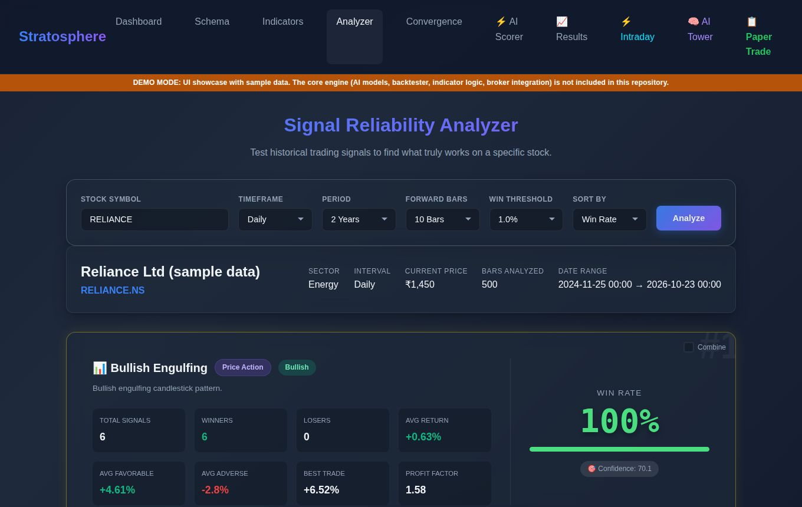
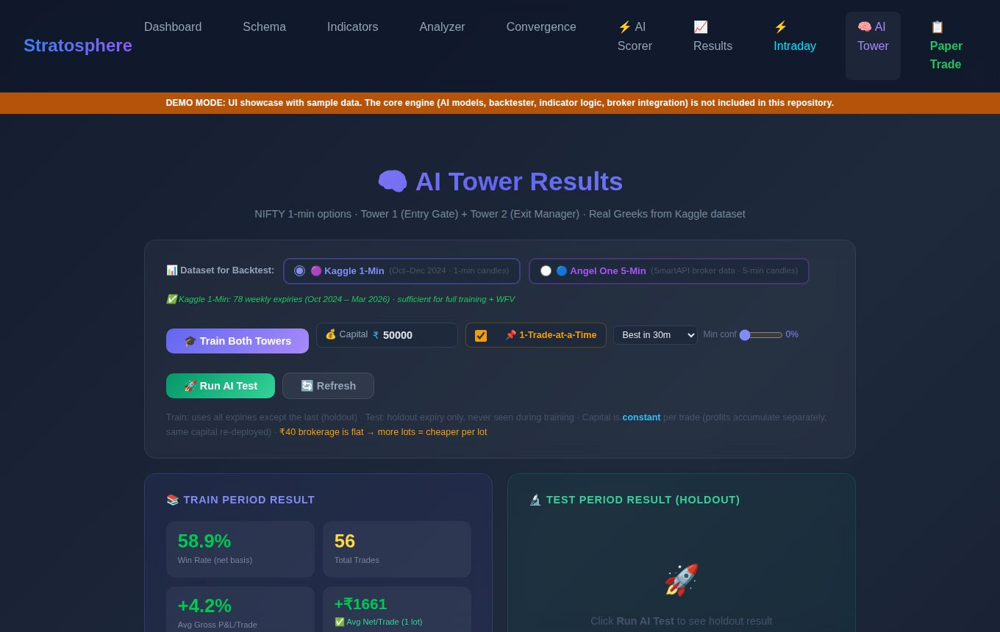

# Stratosphere: AI-Based Strategy Builder & Multi-Factor Confidence Scoring System

Final year project (B.Tech CSE - AI & ML, VISTAS, Chennai)

**Team:** Jeyrenth Siva B, Rokith K, Yeshwandh D  |  **Guide:** Dr. A. Manikandan M.E., Ph.D.

> **UI showcase repository.** This repo contains the complete web interface of the project running on **sample data**.
> The private core (AI models, backtesting engine, indicator logic, broker integration) is intentionally **not included**.
> Actions that need the core engine show a "Demo mode" message.

## About the project
Retail traders struggle with volatile markets, and static indicator strategies fail to adapt. Stratosphere lets a user build
a trading strategy visually, scores its signals with a multi-factor confidence system, and filters trades with a
**Twin-Tower AI**: an *Entry Gate* model that selects high-probability setups and an *Exit Manager* model that predicts
the best exit. Strategies are validated with **5-fold Walk-Forward Validation** on unseen data to avoid overfitting, then
forward-tested through **live paper trading** (no real money).

## Screens in this repository
| Page | What it shows |
|---|---|
| Dashboard | Overview and navigation |
| Schema / Indicators | Strategy schema browser and the indicator catalog |
| Strategy Builder | Visual builder for entry and exit conditions |
| Validator | Strategy JSON validation |
| Signal Analyzer | Signal reliability, combination (confluence) and parameter sweeps |
| Convergence, AI Scorer | Multi-source signal convergence and AI confidence scoring |
| AI Tower | Twin-Tower AI training, backtest and Walk-Forward Validation views |
| Results, Intraday | Backtest results and intraday option backtesting |
| Paper Trade, Trading, Kite Auth | Paper-trading dashboards and broker login screens |

Screenshots are in `docs/screenshots/`.




## Run the UI locally
```bash
python -m venv .venv
# Windows: .venv\Scripts\activate      macOS/Linux: source .venv/bin/activate
pip install -r requirements.txt
uvicorn demo_server:app --reload
```
Open http://127.0.0.1:8000

## Tech stack
Python, FastAPI, Jinja2, HTML5, CSS3, JavaScript (UI). The full project also uses NumPy, Pandas, scikit-learn,
XGBoost and the Angel One SmartAPI (not part of this repository).

## What is not included
AI models and training code, backtesting engine, indicator and signal logic, market data, and broker/API integration.
Numbers shown in the demo (for example in the Analyzer) are **sample data**, not real market results.

## Repository layout
```
demo_server.py     demo backend (serves pages + sample data)
web/templates/     all HTML pages (Jinja2)
web/static/        CSS and JavaScript
mock_data/         sample JSON used by the demo
docs/screenshots/  UI screenshots
```
