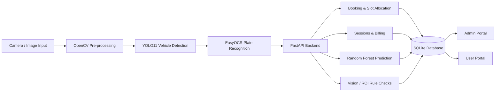

# AI Smart Parking

> **Intelligent parking, end to end.** A connected parking workflow that brings camera recognition, live  monitoring, smart booking, and clear billing into one system.

**FastAPI · SQLite · YOLO11 · EasyOCR · Random Forest**

---

## System at a glance



## Parking workflow

| Step | What happens | Project component |
|---|---|---|
| **1. Book** | The user checks bay availability, chooses a slot, and submits the vehicle plate and details. | User portal, FastAPI, SQLite |
| **2. Enter** | The gate camera detects a vehicle with YOLO and reads its plate with EasyOCR. A confirmed booking receives its reserved bay; an unbooked vehicle can be handled as a walk-in if a bay is available. | `camera/plate_camera.py`, `backend/entry_manager.py` |
| **3. Monitor** | A separate camera process checks configured bay and aisle regions, updates occupancy, and reports observations such as double parking, bay overlap, or aisle obstruction. | `camera/parking_detection.py`, vision API |
| **4. Predict and review** | The Random Forest model predicts availability. The admin portal shows parking activity, bookings, analytics, and alerts. | `ml/parking_prediction.py`, admin portal |
| **5. Exit and pay** | Plate recognition or manual exit creates a pending bill. Confirm the demo payment to release the bay. | `backend/billing_manager.py`, portals |

### Monitoring and anomalies

The app includes software-based anomaly checks for **no-show bookings** and **duplicate active sessions**. Camera-based monitoring is an optional software process that uses a connected camera; no separate Phase 2 controller is described in this project. Start `camera/parking_detection.py` separately from the web server, calibrate its bay and aisle regions for your camera view, and avoid running multiple processes against the same camera device.

The backend stores vision alerts and in-app notifications in SQLite. Vision observations can flag a vehicle in the wrong assigned bay, multiple vehicles in one bay, improper parking, or an obstructed aisle.

## Run locally

Open PowerShell **in the project folder** (`AI Smart Parking`) and run:

```powershell
python -m pip install -r requirements.txt
python -m pip install --force-reinstall --no-deps opencv-python==4.11.0.86
python -m uvicorn backend.main:app --reload
```

The OpenCV reinstall enables the GUI camera preview. It must run after installing the requirements because EasyOCR also depends on headless OpenCV, which does not support `cv2.imshow`. Keep the server terminal open while using the app.

Open these local pages:

- Admin portal: [http://127.0.0.1:8000/dashboard](http://127.0.0.1:8000/dashboard)
- User portal: [http://127.0.0.1:8000/user](http://127.0.0.1:8000/user)
- API documentation: [http://127.0.0.1:8000/docs](http://127.0.0.1:8000/docs)

Demo credentials seeded into an empty database:

- Admin: `admin / admin123`
- User: `user / user123`

On startup, the backend creates the SQLite tables and sample parking slots, then trains the availability model. The database file is `database/parking.db`.

## Billing

Base hourly rates are in INR: Bike ₹10, Car ₹20, Bus ₹40, and Truck ₹40. The first two billable hours use the base rate; later hours use 1.5×. The current policy is available at `/api/billing/rates`. Payment confirmation is a demo action and is not connected to a payment provider.

## Data stored

SQLite stores users, vehicles, parking slots, bookings, parking sessions, parking history, payments, admin credentials, parking alerts, and user notifications.

## Checks and limitations

- Run unit tests with `python -m pytest`. Standalone camera demos are not collected as tests.
- Camera monitoring needs an accessible camera and camera-specific calibration. Use separate devices or configure camera indexes if running both camera scripts at once.
- Keep this project on a trusted local machine for demos. Review authentication before exposing it publicly; the API routes do not consistently apply the authentication check, and demo credentials are stored directly in the database.
